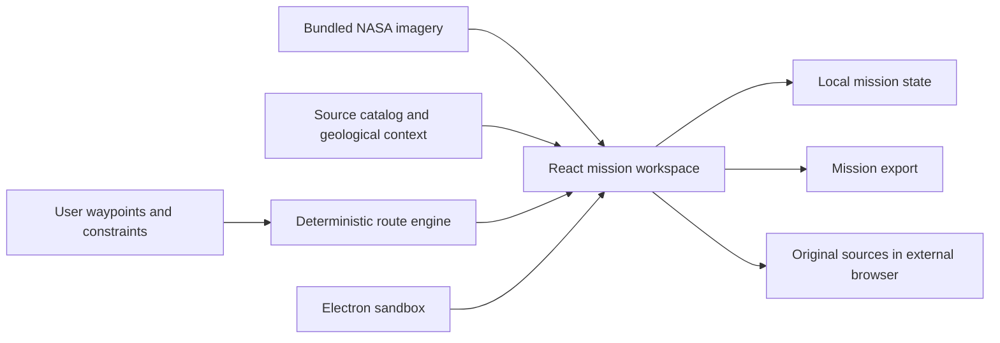

# Architecture

## Platform

AREO uses React and TypeScript with Vite and runs in a Windows x64 Electron application or a modern browser. Field operations opens by default. The field planner loads its registered CTX map and DEM locally, computes routes and daylight without a server, and stores the active plan on the device. The training workspace presents its separate synthetic terrain and workflow.

## Responsibilities

| Component | Responsibility |
| --- | --- |
| React workspace | Map layers, mission configuration, route comparison, scientific context, mission review |
| Planning engine | Offline A* on measured CTX elevations for field operations and a deterministic synthetic grid for training |
| Mars coordinates and clock | Local and Mars-fixed XYZ, projection transforms, Mars24 solar time and daylight limits |
| Bundled data | Reproducible reference imagery and explicitly attributed scientific facts |
| Electron main process | Window lifecycle, local resource delivery, permission denial, safe external links |
| Vite and electron-builder | Browser compilation and Windows portable distribution |

## Data boundaries

Field operations combines a measured DEM subset with its matching orthorectified CTX image in their shared Mars projection. Coordinates and grades use original sample locations and measured elevations. Dwell times, speed and habitat are mission assumptions. The separate training workspace overlays a synthetic grid on a contextual HiRISE image. Read the provenance and route scope before interpreting either result.

The complete offline bundle is versioned with the code. There is no required backend, cloud account, API key, or live network request in the planning path. Source links open in the system browser. Exports should include constraints and model assumptions so another reviewer can reproduce the result.

## Desktop security

The renderer has `nodeIntegration: false`, `contextIsolation: true`, `sandbox: true`, and `webSecurity: true`. It receives no filesystem or shell IPC bridge. A custom `areo://app/` scheme serves only files within the built application directory; resolved paths are checked against that directory. Arbitrary windows, navigations, webviews, and permission requests are denied. Only explicitly listed NASA/USGS and competition HTTPS destinations may open externally. A restrictive Content Security Policy permits bundled scripts, local images, and inline styling needed by the interface.

These choices follow [Electron's security guidance](https://www.electronjs.org/docs/latest/tutorial/security). Packaging uses [electron-builder's Windows targets](https://www.electron.build/win/). The prototype build is unsigned and has no automatic updater.

## Extending toward mission-grade use

Replace the scenario grid with georeferenced digital terrain models and calibrated slope/roughness products; include coordinate reference systems, resolution, uncertainty, and observation time. Import measured spectral products rather than hand-placed demonstration overlays. Connect verified atmospheric and radiation datasets with explicit temporal and spatial applicability. Add crew and vehicle mobility models validated against experiments, uncertainty propagation, redundant storage, and operational verification. Flight operations would require independent validation beyond this competition prototype.
